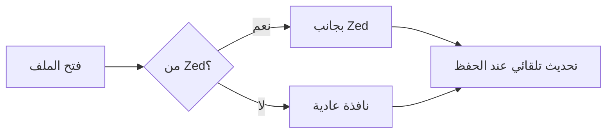
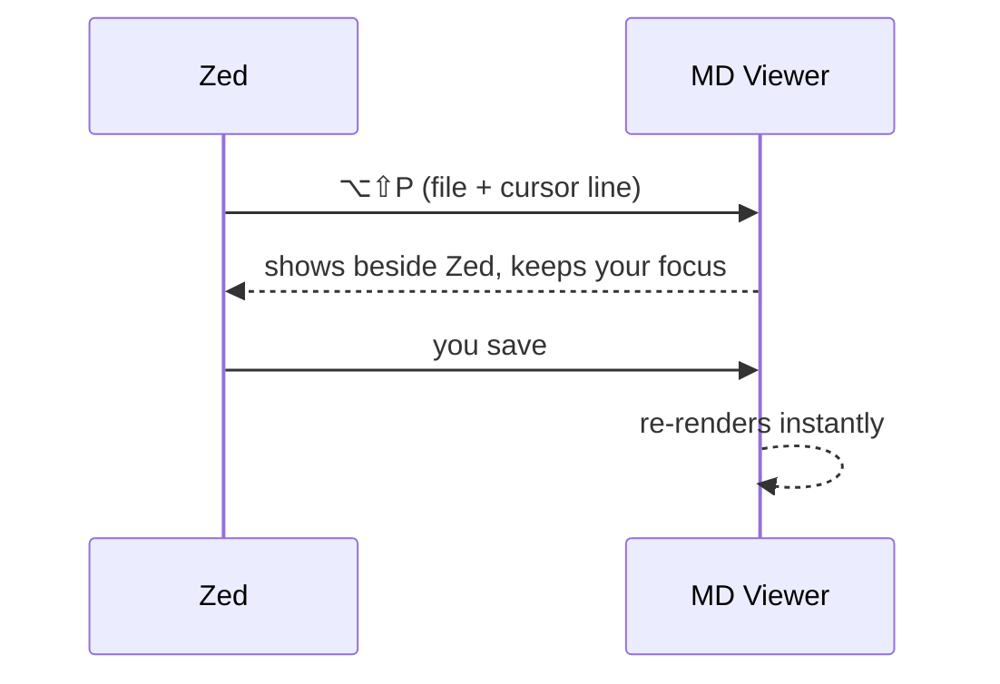

# دليل المميزات

هذا مستند تجريبي يعرض كل ما يدعمه **MD Viewer**: نص عربي من اليمين إلى اليسار، مع كلمات English و `code` داخل السطر.

> [!TIP]
> اضغط <kbd>⌘E</kbd> لفتح المحرر بجانب المعاينة، و <kbd>⌘F</kbd> للبحث في المستند.

## مخطط سير العمل



### قائمة المهام

- [x] دعم العربية والاتجاه من اليمين إلى اليسار
- [x] رسوم Mermaid
- [ ] مهمة لم تكتمل بعد

| الميزة | الحالة |
|--------|--------|
| العربية | ✅ |
| المعادلات | ✅ |
| تصدير PDF | ✅ |

> [!WARNING]
> التعديلات في المحرر لا تُحفظ إلا عند الضغط على <kbd>⌘S</kbd>.

## English section

Everything works left-to-right too. Inline math like $e^{i\pi} + 1 = 0$ and display math:

$$
\sum_{k=1}^{n} k = \frac{n(n+1)}{2}
$$

> [!NOTE]
> Click any diagram to open it full-window. Scroll to zoom, drag to pan.



```swift
// Code keeps left-to-right layout inside Arabic documents.
func greet(_ name: String) -> String {
    "Hello, \(name)!"
}
```

> [!IMPORTANT]
> Links to other `.md` files open in a new tab.

> [!CAUTION]
> Links never launch apps; non-Markdown files are revealed in Finder.

---

### Keyboard

| Action | Keys |
|---|---|
| Open | ⌘O |
| Editor | ⌘E |
| Outline | ⇧⌘O |
| Find | ⌘F |
| Export PDF | ⌘P |
| New tab | ⌘T |
| Zoom | ⌘+ / ⌘− |
| Place beside Zed | ⌥⌘Z |
